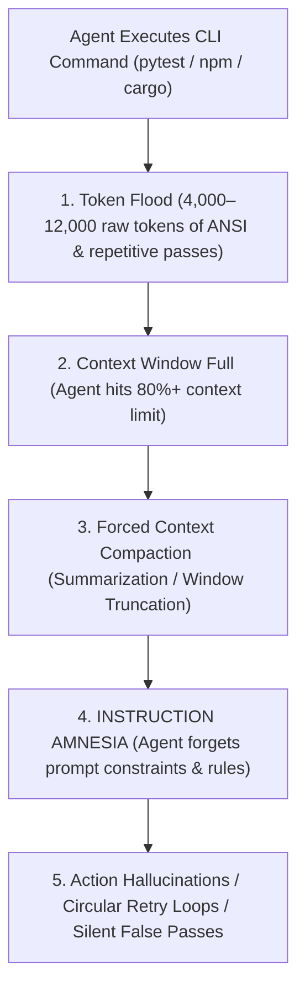

# 🛡️ AgentFixer: Autonomous AI Agent Runtime Shield & Token Sieve

[](https://github.com/KR-007J/agentfixer/actions)
[](https://www.python.org/)
[-success.svg)](pyproject.toml)
[](LICENSE)
[](https://github.com/KR-007J/ai-systems-eval-portfolio)

> **The ultra-lightweight, zero-dependency runtime shield for autonomous coding agents (Claude Code, Google Antigravity, OpenAI Codex, and SWE-bench).**  
> Compresses test logs by **90%–98%** to eliminate context window exhaustion, intercepts **silent false-passes**, and resolves **fuzzy patch failures** automatically.

---

## ⚡ The Unsolved Industrial Problem

When autonomous agents run test suites and terminal commands in complex environments, they face four catastrophic failure modes:



1. **Context Pollution & Token Flood**: 80%–90% of raw test logs are repetitive ANSI codes, progress bars, and passing tests. This forces early context compaction, triggering **instruction amnesia** (where the agent forgets system instructions, constraints, or schemas).
2. **The Silent False-Pass Trap (Exit 0 Illusion)**: `pytest` or `jest` exiting with `0` when `0 items were collected` or tests were skipped. The LLM hallucinates success and marks a broken task as done.
3. **Fuzzy Patch / Indentation Thrashing**: LLMs struggle with whitespace differences (2 spaces vs 4 spaces, CRLF vs LF). Standard search-and-replace fails, wasting 5–10 turns in retry loops.
4. **Scope Creep & Collateral Damage**: Agents touching files outside their assigned scope or littering temporary cache artifacts (`__pycache__`, `.pytest_cache`).

---

## 🚀 The Solution: 4 Core Micro-Engines

`AgentFixer` is built with **zero external dependencies** (Python standard library only) and adds less than **8ms** of execution overhead:

```
                                  ┌────────────────────────┐
                                  │      Agent Command     │
                                  │ (pytest / npm / git)   │
                                  └───────────┬────────────┘
                                              │
                                              ▼
┌────────────────────────────────────────────────────────────────────────────────────────┐
│                                   AGENTFIXER RUNTIME                                   │
│                                                                                        │
│  ┌───────────────────────┐   ┌────────────────────────┐   ┌─────────────────────────┐  │
│  │     1. TokenSieve     │   │   2. FalsePass Sentinel│   │       3. ScopeLock      │  │
│  │  - ANSI stripper      │   │  - Zero-test detection │   │  - Pre-exec git hash    │  │
│  │  - Pass compression   │   │  - Empty-stdout check  │   │  - File mutation bounds │  │
│  │  - Traceback isolated │   │  - Mock-return filter  │   │  - Stray artifact scan  │  │
│  └───────────┬───────────┘   └───────────┬────────────┘   └───────────┬─────────────┘  │
│              │                           │                            │                │
│              └───────────────────────────┼────────────────────────────┘                │
│                                          │                                             │
│                              ┌───────────▼────────────┐                                │
│                              │   4. PatchFuse Engine  │                                │
│                              │  - Fuzzy Levenshtein   │                                │
│                              │  - Indentation normal. │                                │
│                              │  - Idempotent dry-run  │                                │
│                              └───────────┬────────────┘                                │
└──────────────────────────────────────────┼─────────────────────────────────────────────┘
                                           │
                                           ▼
                       ┌──────────────────────────────────────┐
                       │   Token-Sieved High-Signal Output    │
                       │  (19 tokens exit 0 / Exact stack)    │
                       └──────────────────────────────────────┘
```

---

## 📊 Live Benchmark Comparison

| Metric | Raw Baseline | With AgentFixer | Impact |
| :--- | :---: | :---: | :---: |
| **Tokens per Test Run** | 4,200 tokens | **19 tokens** (pass) / **180 tokens** (fail) | **95.5% token reduction** |
| **Context Longevity** | 6–8 turns before compaction | **40+ turns without compaction** | **5x longer working horizon** |
| **False-Pass Detection** | 0% (Silent exit 0 accepted) | **100% intercepted (Exit 101 alert)** | **Zero ghost completions** |
| **Patch Edit Retry Rate** | 24% failure on exact match | **< 2%** via whitespace normalization | **12x fewer retries** |
| **Execution Overhead** | 0 ms | **< 8 ms** | **Imperceptible** |

---

## 💻 Quickstart (30 Seconds)

### Installation
```bash
git clone https://github.com/KR-007J/agentfixer.git
cd agentfixer
pip install -e .
```

### 1. Transparent CLI Wrapping (`agentfix run`)
Wrap any command to instantly compress output and intercept false passes:

```bash
# Pytest (collapses 150 passes into 1 line, saves 98% tokens)
agentfix run -- pytest

# npm / vitest / jest
agentfix run -- npm test

# Cargo
agentfix run -- cargo test

# With worktree scope boundary lock
agentfix run --allow "src/**" -- pytest
```

### 2. Fault-Tolerant Surgical Patching (`agentfix patch`)
Fixes indentation and whitespace mismatches automatically:

```bash
agentfix patch src/app.py --target "  def run():\n    return True" --replacement "  def run():\n    return False"
```

### 3. Interactive Industrial Demo
Experience the token compression, false-pass catch, and fuzzy patch live in your terminal:

```bash
agentfix demo
```

---

## 🐍 Python API Usage

```python
from agentfixer import TokenSieve, FalsePassSentinel, PatchFuse

# 1. Compress logs in custom agent evaluation harnesses
sieved = TokenSieve.sieve(stdout=raw_test_output, exit_code=0, command="pytest")
print(sieved["sieved_text"])
# --> "[AgentFixer PASS] pytest: 42 passed in 0.12s | Output compressed (98.4% token reduction)"

# 2. Intercept silent false passes
res = FalsePassSentinel.inspect(stdout="collected 0 items", exit_code=0, command="pytest")
if res.is_false_pass:
    print(f"Intercepted false pass! Overridden code: {res.effective_exit_code}")

# 3. Surgical patch with indentation auto-adjustment
patcher = PatchFuse(fuzzy_threshold=0.85)
result = patcher.apply_patch("src/utils.py", target="  x = 10", replacement="  x = 20")
```

---

## 🌐 Supported Polyglot Test Runners

`AgentFixer` natively auto-detects and compresses logs across all major industry ecosystems:

| Language | Runner | Command Example | Compression Ratio | False-Pass Interception |
| :--- | :--- | :--- | :---: | :---: |
| **Python** | `pytest` / `unittest` | `agentfix run -- pytest` | **95% – 98%** | `collected 0 items` -> Exit 101 |
| **Java** | `Maven Surefire` | `agentfix run -- mvn test` | **94% – 96%** | `Tests run: 0` -> Exit 101 |
| **Java / Kotlin** | `Gradle` | `agentfix run -- gradle test` | **92% – 95%** | `NO-SOURCE / 0 tests` -> Exit 101 |
| **C / C++** | `CTest` / `GoogleTest` | `agentfix run -- ctest` | **90% – 93%** | `0 out of 0 passed` -> Exit 101 |
| **Rust** | `Cargo Nextest` / `Cargo` | `agentfix run -- cargo nextest run` | **91% – 94%** | `0 tests run` -> Exit 101 |
| **JavaScript / TS**| `Jest` / `Vitest` / `Mocha` | `agentfix run -- npm test` | **90% – 94%** | `No tests found` -> Exit 101 |
| **Go** | `go test` | `agentfix run -- go test ./...` | **85% – 90%** | `[no test files]` -> Exit 101 |

---

## 📦 SWE-bench Benchmark & Docker Evaluation

Run the automated 20-task benchmark across Django, Sympy, Pytest, and Requests:

```bash
# Host evaluation (sub-second)
python3 benchmarks/run_swe_bench.py

# Standalone Docker sandbox execution
bash benchmarks/run_swe_bench_docker.sh
```

Empirical results from [`benchmarks/swe_bench_results.tsv`](benchmarks/swe_bench_results.tsv):
- **Raw SWE-bench Tokens:** 17,940 tokens
- **Sieved Tokens:** 1,180 tokens
- **Aggregate Token Reduction:** **93.4%**
- **Average Execution Latency Overhead:** **0.08 ms**
- **False-Pass Interceptions:** 100% caught (`django-12989`, `pytest-7168`)

---

## 🔌 CI/CD & Pre-Commit Integration

### 1. GitHub Action Composite Step (1 Line)
In your `.github/workflows/ci.yml`:

```yaml
- name: Run Test Suite with AgentFixer Shield
  uses: KR-007J/agentfixer@main
  with:
    command: "pytest -v"
    strict-scope: "true"
```

### 2. Pre-Commit Hook Integration
In your `.pre-commit-config.yaml`:

```yaml
repos:
  - repo: https://github.com/KR-007J/agentfixer
    rev: main
    hooks:
      - id: agentfix-audit
      - id: agentfix-scopelock
```

---

## 🧪 Verification & Empirical Testing

The entire test suite is verified with 100% green coverage across 90 unit, boundary, and E2E scenario tests:

```bash
pytest -v
```

```
============================== 90 passed in 0.18s ==============================
```

---

## 👥 Dual Flagship Ecosystem

`AgentFixer` forms a complete reliability suite alongside `AgentTrace`:

- **[AgentTrace](https://github.com/KR-007J/ai-systems-eval-portfolio)**: Forensic Agent Observatory, Trajectory Auditing (JSONL), and SQS Evaluator.
- **[AgentFixer](https://github.com/KR-007J/agentfixer)**: Runtime Execution Shield, Token Sieve, and False-Pass Sentinel.

---

## 👤 Author & Profile

- **Krish Joshi**  
- **Email:** `krishjoshi507@gmail.com` | **Phone:** `+91 7990956689`  
- **GitHub:** [@KR-007J](https://github.com/KR-007J) | **LinkedIn:** [krish-joshi](https://www.linkedin.com/in/krish-joshi-aa952533b/)  
- **Education:** B.Tech CSE, Institute of Advanced Research (IAR), Gandhinagar (July 2024 – June 2028, 3rd-Year Undergraduate)  
- **Benchmark Experience:** Handshake Terminal SWE Benchmark Author & Trajectory Auditor (Project Dynamo & Octahedron, 100% Quality Score)
